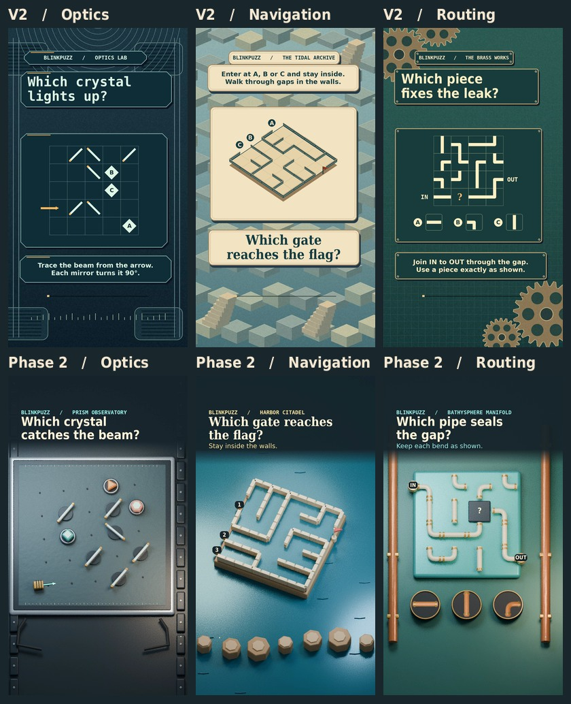

# Gameplay on the opening frame

The top row shows frame zero from the reproduced 20-film V2 archive. The bottom row shows frame zero from the corresponding Phase 2 families. Both rows use the same scale. The V2 reference ZIP reproduced the reviewed archive's SHA-256, `4aca768ea16d44f8c573e5886407aaa01967f5e9119c01145edc9ccb0d1f439f`.

| Mechanic | What changes for the viewer |
| --- | --- |
| Optics | The emitter, mirror strips and three faceted receivers share one optical bench. The beam follows the same centers and mirror normals used to solve the board. Each receiver can be identified by its silhouette. |
| Maze | Raised walls enclose the water. The three gate numbers sit on their entrances, and a pennant marks the destination. A moving pointer traces the connected waterway. The pennant is small at contact-sheet scale. |
| Pipes | The inlet, outlet, flanges and three loose spools are physical fittings. The correct spool travels into the opening in its displayed orientation. The fill follows the connected pipe centerline. |

The four new families ask the viewer to recognize a moth, compare controls, fit a keyed insert or project a silhouette. Their strongest distinctions are visible on the opening frame. The repeated headline treatment is still conspicuous when viewing an entire contact sheet. Moth eyespots and gear teeth are fine detail on a small phone. Static Cycles lighting gives the models volume, but limited sampling leaves grain, and the composited moving parts keep their baked lighting. Two-second understanding and the appeal of the reveals still need independent viewers.

The source pairs are V2 episodes 01, 02 and 04 and Phase 2 episodes 01, 02 and 06. The collection also includes full-resolution first and final video frames for every episode.
